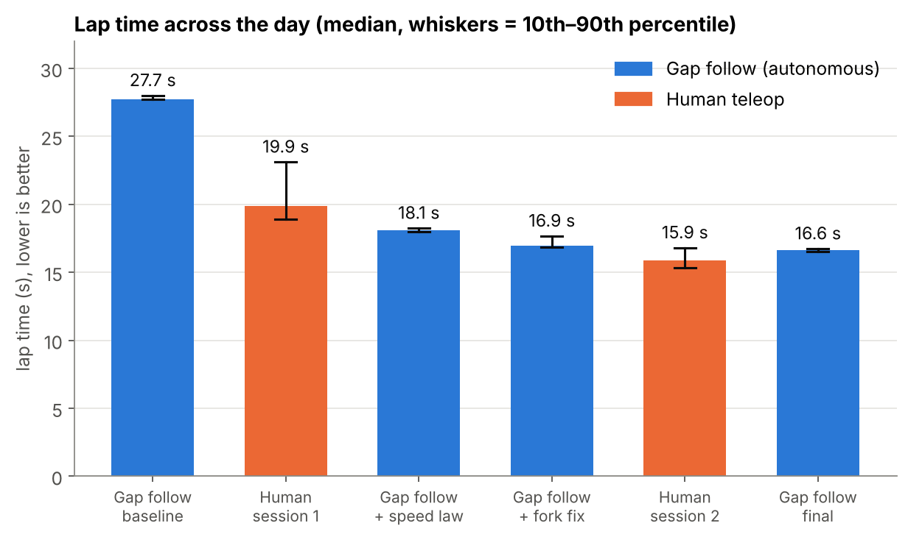

# Swat-F1tenth · Swarthmore Roboracer

We are a student team at Swarthmore College building **1/10-scale autonomous race cars** on the
[F1TENTH](https://f1tenth.org) platform. We work on fast, safe autonomous racing that runs entirely on the car's onboard sensors
and computer.

**Platform:** NVIDIA Jetson · Hokuyo 2D LiDAR · VESC motor controller · ROS 2 Foxy · Python

---

## Repositories

| Repo | What it is |
|---|---|
| [**swat-f1tenth**](https://github.com/Swat-F1tenth/swat-f1tenth) | **Start here.** Our ROS 2 workspace: all driving algorithms (`auto/`), launch files, setup guides and test results |
| [f1tenth_system](https://github.com/Swat-F1tenth/f1tenth_system) (`swat-foxy`) | Fork of the F1TENTH car drivers with our calibration: VESC, joystick, LiDAR config, bringup launch |
| [vesc](https://github.com/Swat-F1tenth/vesc) (`swat-foxy`) | Fork of the VESC ROS driver with our odometry fix (pulled in as a submodule of f1tenth_system) |

The simulator is the upstream [f1tenth_gym_ros](https://github.com/f1tenth/f1tenth_gym_ros), pulled in by
`sim.repos`.

## How the stack fits together

```
 LiDAR /scan ─┐                                    joystick /teleop (priority 100)
              ├─► planner ─► /nav_drive ─► AEB gate ─► /drive (priority 10) ─► ackermann_mux ─► VESC
 VESC  /odom ─┘   (gap follow, pure pursuit,  (stops on time-to-collision)
                   wall follow)
```

* **Planners:** Follow-the-Gap with disparity extension (our main racer), Pure Pursuit (waypoints), and PID wall follow
* **Safety:** every planner passes through an automatic emergency brake (AEB), and the human joystick always overrides

## Getting started

```bash
mkdir -p ~/swat_ws/src && cd ~/swat_ws/src
git clone https://github.com/Swat-F1tenth/swat-f1tenth.git
vcs import < swat-f1tenth/car.repos      # on the car   (use sim.repos on a laptop)
cd ~/swat_ws && rosdep install --from-paths src --ignore-src -y
colcon build --symlink-install && source install/setup.bash
```

Full instructions are in the [swat-f1tenth README](https://github.com/Swat-F1tenth/swat-f1tenth#readme).

---

## Latest results: autonomy vs. human (V0, Nov 2026)



* Autonomous lap time **27.7 s → 16.6 s (−40%)** in one day of data-driven tuning
* **Within 4.5%** of a practiced human driver, and **16% faster** than the same driver's first session
* **6.5× more consistent** lap to lap (0.23 s vs. 1.49 s spread)

Full write-up with methods and limitations: [results.md](https://github.com/Swat-F1tenth/swat-f1tenth/blob/main/docs/v0_results/results.md)

---

## Contributing

Never push to `main`; open a pull request. Develop on a laptop, not on the Jetson.
