# Autonomous racing V0: Follow-the-Gap vs. human teleop

One day of testing (2026-11-20) on a 1/10-scale F1TENTH car (ROS 2 Foxy, Hokuyo LiDAR, VESC) on an indoor
cardboard track. We compared our reactive **Follow-the-Gap** planner against a human driving the same car by
joystick, using only data recorded in ROS bags.

**Headline:** in one day of log-driven tuning, the autonomous lap time dropped from **27.7 s to 16.6 s (−40%)**.
The car now laps **within 4.5% of a practiced human driver**, beats the same driver's first session by **16%**, and
is **6.5× more consistent** lap to lap.

  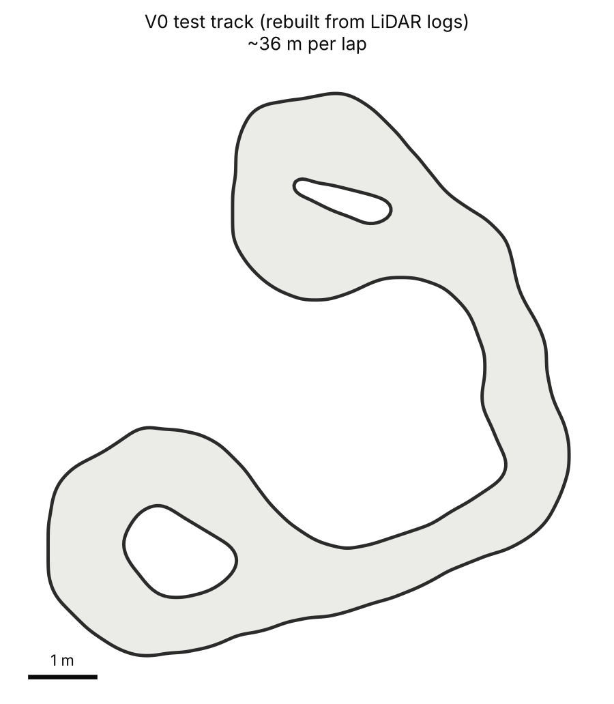
  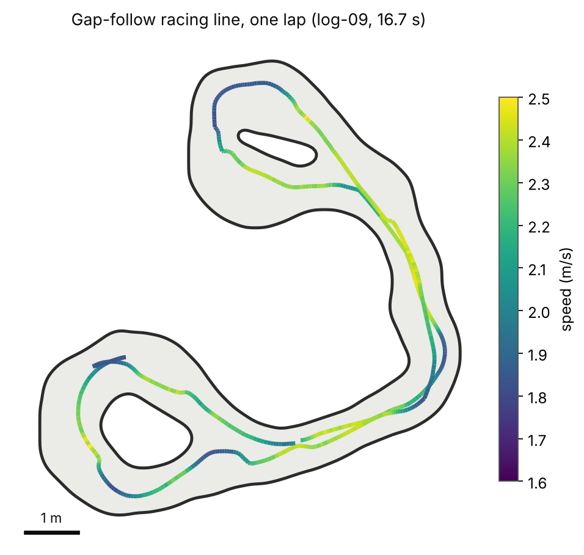

## Results at a glance

| Session | Driver | Median lap | 10th–90th pct lap | Avg speed | Time at ≥2.3 m/s | Closest wall approach* |
|---|---|---|---|---|---|---|
| Baseline (morning) | Gap follow | 27.7 s | 27.7–28.0 s | 1.26 m/s | 0% | 0.29 m |
| Human session 1 | Teleop | 19.9 s | 18.9–23.1 s | 2.00 m/s | 29% | 0.15 m |
| + speed law | Gap follow | 18.1 s | 18.0–18.2 s | 1.96 m/s | 18% | 0.25 m |
| + fork fix, faster corners | Gap follow | 16.9 s | 16.9–17.7 s | 2.10 m/s | 35% | 0.25 m |
| Human session 2 (practiced) | Teleop | **15.9 s** | 15.3–16.8 s | 2.28 m/s | 76% | 0.18 m |
| **Final** | **Gap follow** | **16.6 s** | **16.5–16.7 s** | 2.20 m/s | 45% | **0.27 m** |

\* 1st percentile of the nearest LiDAR return while driving (higher means more margin to the walls).

| Comparison | Result |
|---|---|
| Autonomous lap time, baseline → final | 27.7 s → 16.6 s (**−40%**, 1.67× faster) |
| Autonomous average speed | 1.26 → 2.20 m/s (**+75%**) |
| Final gap follow vs. human session 1 | **16% faster** (16.6 s vs. 19.9 s) |
| Final gap follow vs. human session 2 | 4.5% slower (16.6 s vs. 15.9 s) |
| Lap-to-lap spread (10th–90th pct) | 0.23 s vs. 1.49 s for the practiced human (**6.5× more consistent**) |
| Closest wall approach | 0.27 m vs. 0.18 m for the practiced human (**+50% margin**) |

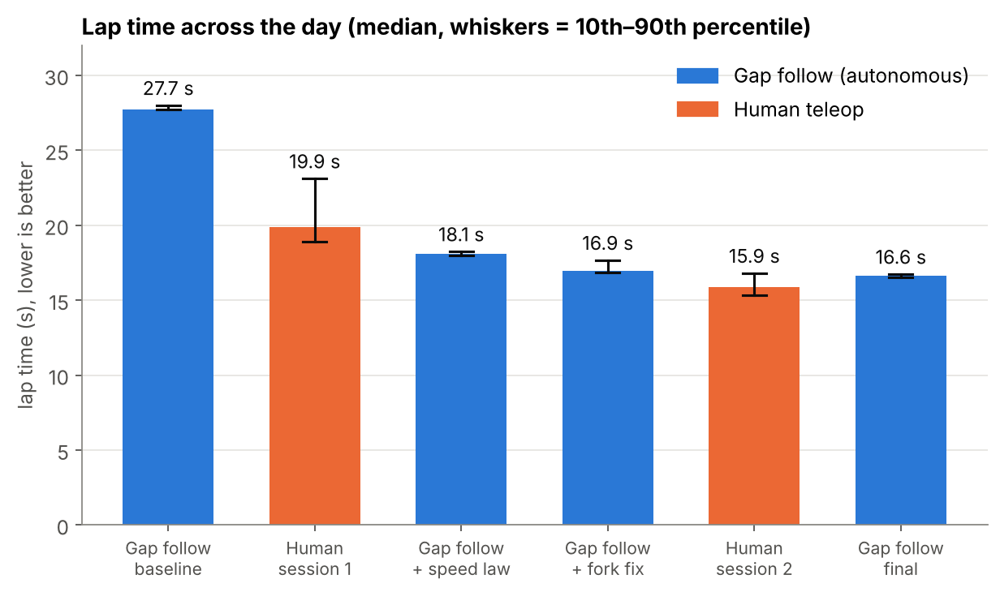
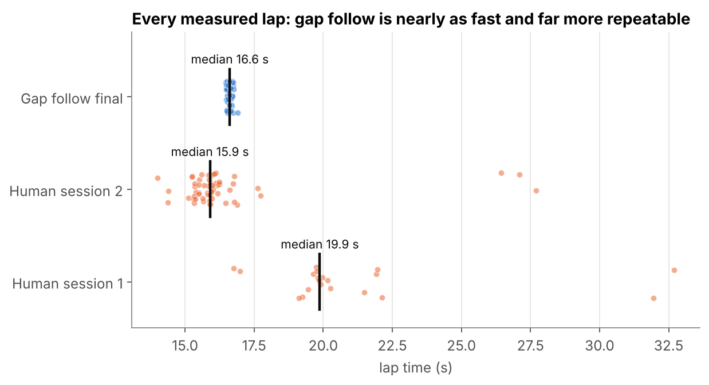
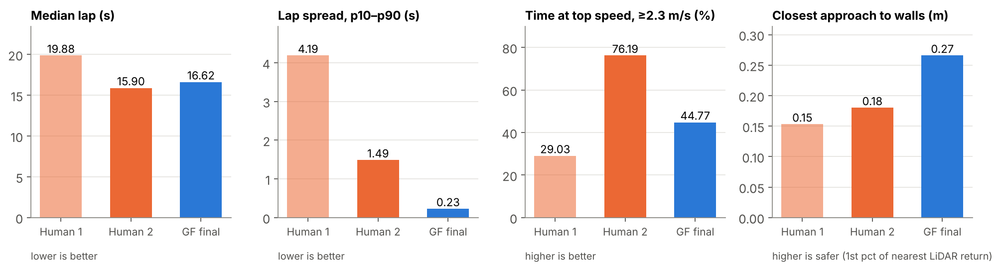

**Where the human still wins:** the human holds the 2.45 m/s joystick cap for 76% of the lap and brakes briefly
and late. Gap follow never drops below ~1.8 m/s, but it reaches top speed only 45% of the time.

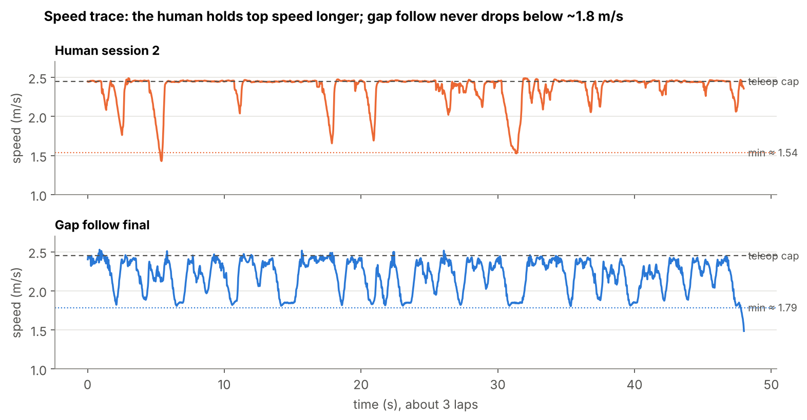
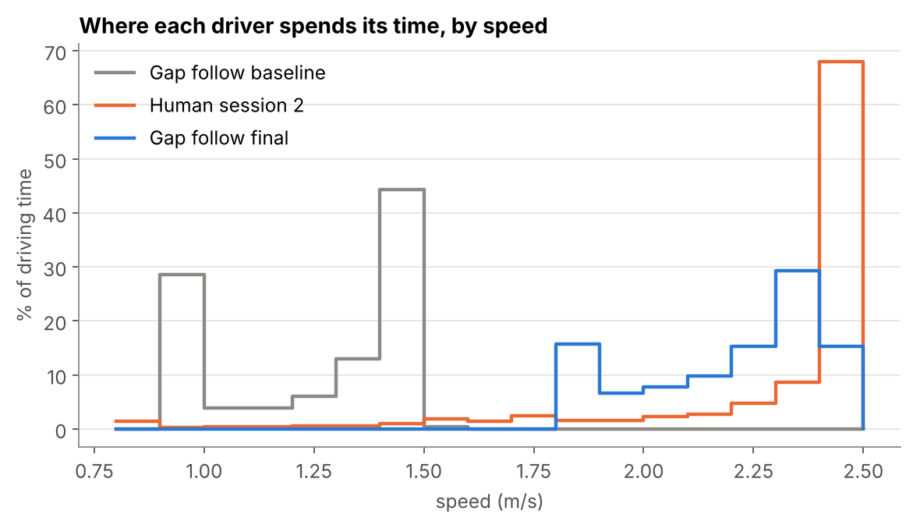

## The algorithm

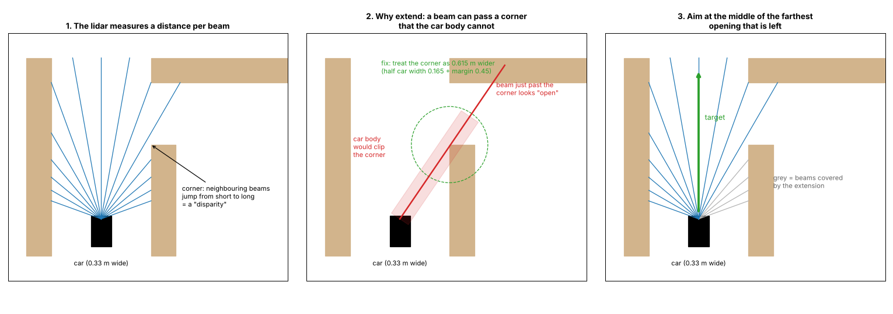

`auto/auto/follow_the_gap_v2.py`, one LiDAR scan in, one Ackermann command out (40 Hz):

1. **Preprocess:** keep beams within ±70° of straight ahead and cap ranges at 4 m.
2. **Disparity extension:** wherever two neighbouring beams jump by more than 0.35 m, "grow" the nearer obstacle by
   half the car width plus a safety margin, so the car never aims at a gap it cannot fit through.
3. **Target selection:** steer to the middle of the deepest free region. A *sticky* rule holds the previous
   direction (±20°) at forks unless another direction is clearly deeper. The hold is released when the held direction
   is less than 2 m deep, or after 0.5 s.
4. **Steering:** exponential smoothing of the target angle (α = 0.6).
5. **Speed law:** speed rises with the free depth toward the target, using a braking model fitted to measured
   deceleration, and falls with the steering angle. Floor `V_CORNER`, cap `V_MAX` = 2.5 m/s.
6. **Safety:** commands go through an AEB gate (time-to-collision on `/odom` + `/scan`) before reaching the
   ackermann mux. The human joystick always has priority.

### Key fixes found from the logs

* **Disparity-extension cascade bug.** Obstacles were extended into an array that was already being overwritten,
  so extensions chained into fake walls. This blinded 8% of scans (no direction deeper than 1 m). Detecting edges on
  an untouched copy of the scan brought that to 0% and cut wrong-direction steering flips by ~70% in offline replay.

  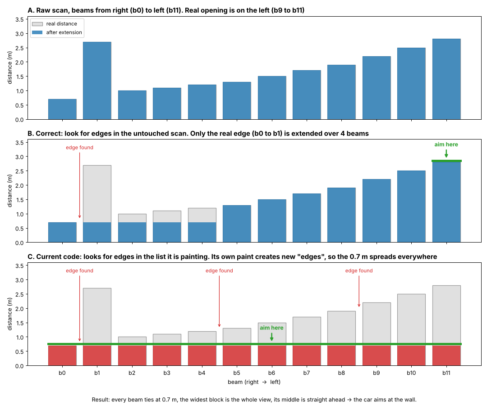
  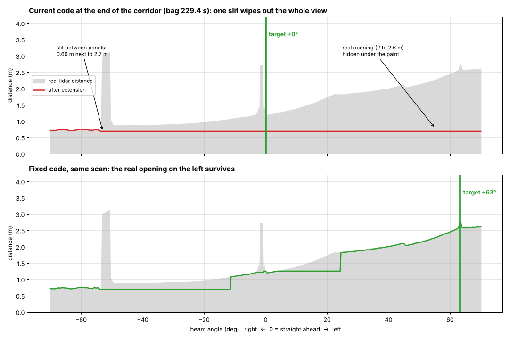
* **Fork zig-zag and fork circling.** Two equally deep branches made the target flip every scan. A hysteresis
  ("sticky") rule fixed the flip. A depth release and a 0.5 s timeout stopped it from trapping the car in one loop.
* **Braking.** A brake test showed the VESC speed loop brakes in proportion to the speed error. Asking for zero
  slows the car at ~1.5 m/s², but small speed steps (1.5 → 1.0 m/s) brake at under 1 m/s². This explained the late
  braking and shaped the speed law.

  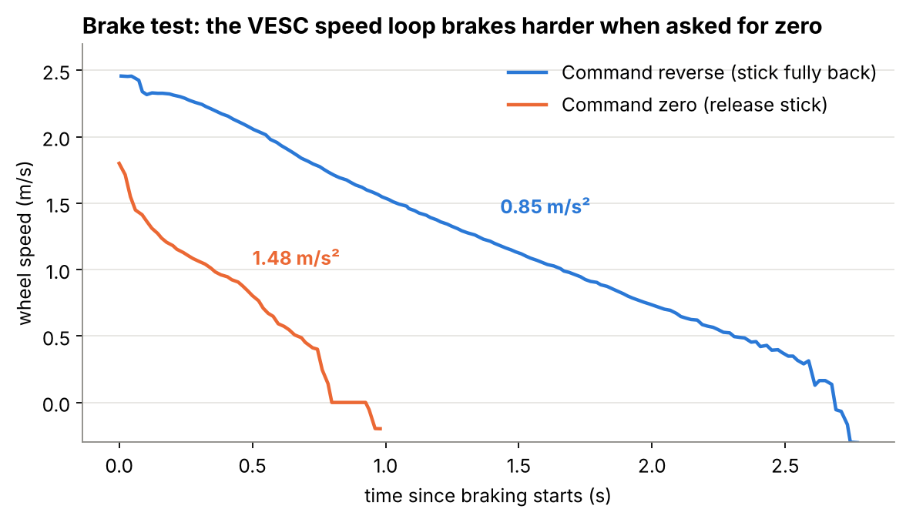

## How the numbers were measured

* All data comes from `ros2 bag` recordings (`/scan`, `/odom`, `/joy`, `/drive`, `/aeb`).
* **Lap times** come from LiDAR scan matching: a lap ends when the car sees the same scan again after ~36 m of
  odometry distance. Each session reports a *rolling* lap time measured from every start point (20–60 samples per
  session).
* **Track map:** ICP scan-matching SLAM on the slowest run, cleaned and smoothed. It is also available as a ROS map
  (`track_v0.pgm` / `track_v0.yaml`) for the F1TENTH gym simulator.

### Limitations (V0)

One driver, one day, one track. There are 2–9 laps per session. The joystick capped the human at 2.45 m/s, and the
autonomous runs used the same cap. Collisions are not compared, because the cardboard track was coming apart during
the final runs. The next step (V1) is 10+ laps per mode with frozen parameters, with confidence intervals as in the
benchmark plan.
